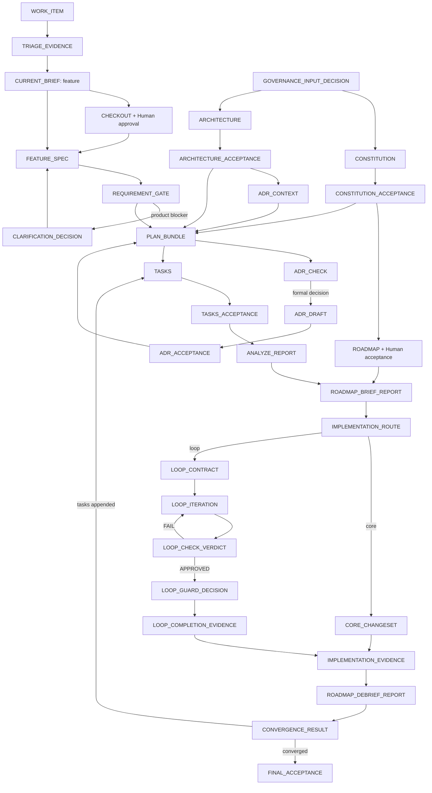
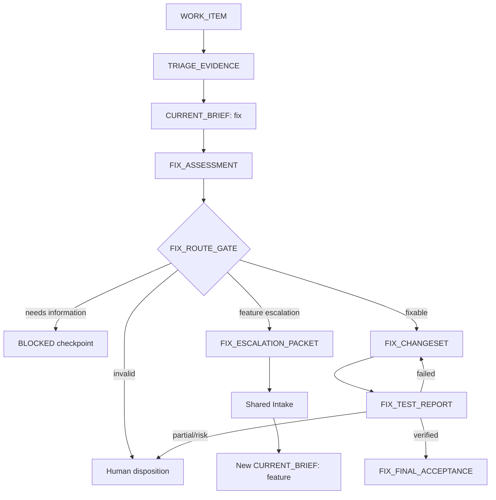

```yaml
coach_stage: W3
decision: ACCEPTED
source_project: capability-sample-robox-nexus
source_revision: git:d24411c8840bab361745c1ed7b41cf4b3a43b3e3+mapping:sha256:8ab657d28bbb9ac295dd7c3c12d6cf9e54b150a2b6f2b29d6af4b7ccdbe3b6b8
requirements_revision: sha256:3b6caab15839cd7489bf30c23f9598a45fa309a3ade7a6227597ab83cb237d94
input_artifacts:
  - analysis/w2-capability-rationalization.md#sha256:9cf7ee6b5ed3c2c3b9c8352f278e365f142fedd0ee34f52a14da4330021fc0fe
  - requirements/orchestration-requirements.md#sha256:3b6caab15839cd7489bf30c23f9598a45fa309a3ade7a6227597ab83cb237d94
  - contracts/handoff-gate-contracts.md#sha256:eef42b00a7630f5c801d87fe0bce9403fb09cea8f5625df7f72e0bcfc8c7cfbd
decisions:
  default_worktree: false
  loop_eligible: true
  loop_isolation: none
  artifact_dependency_model_accepted: true
open_blockers: []
supersedes: analysis/w3-artifact-dependencies.md#sha256:7dc23a66bdbdd8eb4f9e443e657cbd77cb9e9933600daaa54cd0b973947bea78
```

# W3 产物契约与依赖图

## 1. 本步骤结论

工作流不再以“Agent A 调 Agent B”的会话顺序表达，而以当前 artifact revision、GateRecord 和 HandoffRef 驱动。W3 固定了以下基础设施：

- [`../contracts/handoff-gate-contracts.md`](../contracts/handoff-gate-contracts.md) 是 `ArtifactRef`、`CheckoutRef`、`ChangesetCandidateRef`、`CommitRef`、`PullRequestRef`、`IntegrationRef`、`PromotionRef`、`MergeResolutionRef`、`HumanDesignationRef`、`HumanDecisionRef`、`ImplementationRouteRef`、`GateRecord`、`HandoffRef`、`LeaseRecord` 和 `LoopStateRef` 的唯一 schema 来源。
- [`../contracts/branch-and-commit-policy.md`](../contracts/branch-and-commit-policy.md) 固定 GitFlow branch/base/target、candidate/commit boundary、PR/integration/promotion 和 Conventional Commit Work-Item footer。
- 每个 Feature/Fix 在首个 producer 前必须有 current `HumanDesignationRef`；`multica auth status` account email 已获 explicit consent。普通 Feature 在 Specify 前、初始化/重大调整在 governance-input 前、Fix 在 Assess 前。
- Feature/Fix 的全部代码和 feature-local artifacts 绑定一个 Project/Runtime 批准的 `CheckoutRef(base=develop,target=develop)`；Loop 复用该 checkout，`loop_isolation: none`。
- 每个需要 immutable repository revision 的独立 reviewer、Human Gate 或 CI 前，必须消费 current `CommitRef`，而不是可变 working tree；最终 completion 必须消费 `IntegrationRef`，Release/Hotfix 必须消费 complete `PromotionRef`。

## 2. Artifact root 与稳定引用

| 范围 | Canonical root/locator | Revision 规则 | 禁止做法 |
| --- | --- | --- | --- |
| Multica Issue/PR/Brief/comment/run | provider 返回的 opaque ref | provider immutable revision 或 write-after-readback ref | 按标题搜索猜最新对象；模板写 live UUID |
| Project governance | `.specify/memory/constitution.md`、`.specify/memory/architecture.md`、configured roadmap path、configured ADR corpus | 文件 SHA-256 + git revision；Human decision 绑定精确 diff/revision | 把报告当 governance SSOT；AI 自行 ratify |
| Feature | `CheckoutRef.root_locator` 下的 resolved `FEATURE_DIR` | 文件 SHA-256；changeset 使用 git revision/diff ref | 下游重新解析到主 checkout；跨 worktree 混用 artifacts |
| Fix | approved repository root 下 `.specify/bugs/<slug>/` | assessment/fix/test 各自 SHA-256 + changeset evidence | 覆盖既有 slug；用 Feature artifacts 替代 Fix report |
| Workflow ledger | W7 指定的单一 provider 持久化接口 | append-only record revision + `supersedes` | 只留在聊天上下文；重写旧 Gate |

Artifact logical identity 使用：

```text
<work_type>:<work_item_ref>:<artifact_kind>
```

同一逻辑产物的内容改变时保持 `artifact_id`，更新 `revision`，旧引用改为 `SUPERSEDED`。Consumer 必须消费 `artifact_id@revision`，不能只写“current spec”或“latest report”。

## 3. 共享入口与执行上下文产物

| Artifact kind | Producer boundary | 必需输入 | Consumers | 稳定 locator | 客观检查 | Invalidation |
| --- | --- | --- | --- | --- | --- | --- |
| `WORK_ITEM` | Reporter/Human/provider | Issue 或 PR 输入 | Shared Intake | provider Issue/PR ref | 身份唯一、当前 body/comments/status 可读 | Issue scope/title/body 的语义变化触发重新 triage |
| `TRIAGE_EVIDENCE` | Shared Intake | WORK_ITEM、repository evidence、comments、runs、PR diff | CURRENT_BRIEF、classification gate | workflow ledger artifact ref | 来源、revision、复现/需求证据和未决项完整 | 任一引用证据更新则 stale |
| `CURRENT_BRIEF` | Shared Intake | TRIAGE_EVIDENCE、Human clarification | Feature 或 Fix Leader | current Brief comment/file ref + version | 恰好一个 work_type、目标、scope/non-goal、AC、依赖、权限、artifacts、reviewer、acceptance 完整 | Brief revision 或 work_type 改变使全部下游 handoff/gate stale |
| `HUMAN_DESIGNATION` | operator + designated Human | `multica auth status` account email、explicit consent、CURRENT_BRIEF（work-item override 时） | 所有首个 producer 与后续 Human gate | workflow ledger designation ref | account email+consent current；portable package 不含 email | designation/email/consent/Brief/work type/scope 改变；缺失或撤销时 BLOCKED |
| `STATUS_CONTRACT_CONFIRMATION` | Human | accepted status contract、Multica Web | Shared Intake、provider control | 不持久化；Human 明确同意即可 | 五个 display/key/category 已由 Human 核对并同意；不要求 evidence ref | workspace definition 改变或 Human 撤回同意时重新核对；未确认时阻止 apply/dispatch |
| `CHECKOUT` | Project/Runtime/repository integration + Human approval | CURRENT_BRIEF、branch policy | 所有会写/读 Feature/Fix path 的节点 | CheckoutRef.v3 | GitFlow branch role、base/target/root/head、provisioning receipt 唯一且批准 | root/branch/base/target/head/provider/policy 改变使全部 path/code-derived artifacts stale |
| `CHANGESET_CANDIDATE` | 当前 repository-writing artifact Producer | CHECKOUT、approved scope、actual diff/tests | 同一 producer run 的 commit step、commit-policy-reviewer | provider/ledger candidate ref | paths/diff/parent revision 可复算；无 unrelated dirty work | candidate/parent/scope/diff 改变即 stale |
| `COMMIT` | 当前 repository-writing artifact Producer | current CHECKOUT、CHANGESET_CANDIDATE、commit policy readback | commit-policy-reviewer、下游 reviewer、Human Gate、CI | producer-owned immutable CommitRef.v2 | SHA lineage、provider run identity、Conventional Commit、Work-Item footer、candidate mapping 精确 | 新 commit 使旧 verdict/review/CI/final acceptance stale |
| `PULL_REQUEST` | repository provider | current CommitRef、current checkout、required CI/approval | Human final acceptance、provider integration | PullRequestRef | source/head=current CommitRef；Feature/Fix target=`develop`、Release/Hotfix target=`main` | head/base/target/check/approval 改变即 stale |
| `INTEGRATION` | repository provider | current PullRequestRef、required check/approval receipts | Leader/Issue lifecycle/Promotion | IntegrationRef | provider server merge commit、exact head/target/readback 完整 | merge/head/target/receipt 改变即 stale |
| `PROMOTION` | repository provider + Human | primary IntegrationRef、back-merge、tag/conflict receipts | Release/Hotfix lifecycle | PromotionRef | required back-merge 和 tag（适用时）完整 | 任一 primary/back-merge/tag/resolution 改变即 stale |
## 4. Governance 产物矩阵

这些产物只在初始化或已证明的 amendment 路径启用；普通 Feature 不例行重跑。

| Artifact kind | Producer boundary | 必需输入 | Consumers | Stable locator | 客观检查 | Invalidation |
| --- | --- | --- | --- | --- | --- | --- |
| `GOVERNANCE_INPUT_DECISION` | Human Authority | authorized sources、目标、change scope | Governance Producer | HumanDecisionRef | Human identity、授权范围、sources、decision 完整 | Human 撤回/修改授权即 stale |
| `CONSTITUTION` | Governance Producer via `speckit-constitution` | GOVERNANCE_INPUT_DECISION、现有 Constitution | Human Constitution Review、Plan/Analyze | `.specify/memory/constitution.md` | 无占位、版本/原则/治理规则一致、实际 diff 可审查 | revision 改变使受影响 Architecture/Plan/Tasks/Analyze gates stale |
| `CONSTITUTION_ACCEPTANCE` | Human Authority | CONSTITUTION revision + actual diff | Architecture/Feature planning | HumanDecisionRef | subject=constitution、decision=ACCEPTED、精确 revision | Constitution revision 改变即 stale |
| `ARCHITECTURE` | Governance Producer via `speckit-constitution` | GOVERNANCE_INPUT_DECISION、repository technical evidence、CONSTITUTION | Human Architecture Review、ADR/Plan/Analyze | `.specify/memory/architecture.md` | observed/inferred/approved-target/gap 分离，stable IDs 与 evidence 完整 | revision 改变使 governing ADR context、Plan、Tasks、Analyze stale |
| `ARCHITECTURE_ACCEPTANCE` | Human Authority | ARCHITECTURE revision + actual diff | ADR/Plan | HumanDecisionRef | subject=architecture、Human ACCEPTED | Architecture revision 改变即 stale |
| `ADR_CONTEXT` | ADR Context Reader | accepted Architecture、ADR corpus、Feature paths | Plan | ArtifactRef/provider output ref | JSON 可解析、corpus revision/paths 明确 | Architecture/ADR corpus/Feature paths 改变即 stale |
| `ADR_CHECK` | Architecture Reviewer | PLAN_BUNDLE、ADR_CONTEXT、ADR corpus/snapshot when configured | ADR Draft route、Tasks | ArtifactRef/provider output ref | governing decisions 有证据；snapshot 缺失不得声称 deterministic routing | Plan/ADR corpus/snapshot 改变即 stale |
| `ADR_DRAFT` | Architecture Draft Producer | PLAN_BUNDLE、ADR_CHECK finding、Human drafting authorization | Human ADR Review | configured ADR corpus path | schema-valid、status=draft、scope/options/tradeoffs/consequences 完整 | Plan/Architecture revision 改变需重审 |
| `ADR_ACCEPTANCE` | Human Authority | ADR_DRAFT + actual diff | Plan resume、Tasks/Analyze | HumanDecisionRef | subject=adr、ratify/reject/修改决定明确 | ADR revision/status/supersession 改变即 stale |
| `ROADMAP` | Roadmap Writer | accepted governance、Human roadmap input/delta | Roadmap Brief/Debrief/Sync | configured roadmap path | ledger entry IDs、scope/outcome/dependencies/status/version 可判定 | relevant entry revision 改变使对应 brief/debrief stale |
| `ROADMAP_ACCEPTANCE` | Human Authority | ROADMAP revision + actual diff | Feature Leader、Roadmap Reviewer | HumanDecisionRef | subject=roadmap、ACCEPTED、delta 范围明确 | Roadmap revision 改变即 stale |
| `ROADMAP_SYNC_REPORT` | Roadmap Reviewer | ROADMAP、spec inventory、ADR corpus | Human/Roadmap Writer | timestamped report path | orphan/phantom/status/dependency/ADR drift 有 evidence | 任一输入 revision 改变后报告仅历史有效 |

## 5. Feature 主路径产物矩阵

| Artifact kind | Producer boundary | 必需输入 | Consumers | Stable locator | 客观检查 | Invalidation |
| --- | --- | --- | --- | --- | --- | --- |
| `FEATURE_SPEC` | Requirement Producer via `speckit-specify` | CURRENT_BRIEF、CHECKOUT、authorized sources | Requirement Reviewer/Clarifier/Plan | `FEATURE_DIR/spec.md` | WHAT/WHY、scope/non-goal、AC、stable semantic refs、source provenance 完整 | Brief/spec revision 变化使 Requirement Gate 及其全部下游 stale |
| `REQUIREMENT_GATE` | Requirement Reviewer via `speckit-checklist` | FEATURE_SPEC、canonical rule fragments | Clarifier 或 Plan | `FEATURE_DIR/checklists/requirements.md` | contract/version/spec SHA、六 logical gates、PASS evidence/open blockers 完整 | Spec 或 rule fragment revision 改变即 stale |
| `CLARIFICATION_DECISION` | Human + Clarifier | product-decision blockers、FEATURE_SPEC | updated FEATURE_SPEC/REQUIREMENT_GATE | spec clarification section + HumanDecisionRef | 每个问题有接受答案，stable refs 同步 | 回答或 spec revision 改变即 stale |
| `PLAN_BUNDLE` | Feature Planner via `speckit-plan` | accepted governance refs、FEATURE_SPEC、REQUIREMENT_GATE READY、ADR_CONTEXT、repository facts | ADR Check、Tasks、Analyze | `FEATURE_DIR/plan.md` + declared bundle paths | `PLAN_OUTPUT_READY` 派生；X0–X4、design refs、test conditions、VAL paths 完整 | 任一 direct input revision 改变使 bundle 和全部下游 stale |
| `TASKS` | Task Planner via `speckit-tasks` | PLAN_BUNDLE、FEATURE_SPEC | Human Tasks Review、Analyze、chosen writer | `FEATURE_DIR/tasks.md` | task IDs、paths、dependencies、parallel markers、tests、final review 可执行 | Plan/Spec/Tasks revision 或 Convergence append 使 review/analyze/implementation gates stale |
| `TASKS_ACCEPTANCE` | Human Authority | TASKS revision + actual diff | Analyze | HumanDecisionRef | 覆盖、粒度、路径、依赖、并行、验证、blocker 被 Human 接受 | Tasks revision 改变立即 stale |
| `ANALYZE_REPORT` | Independent Plan Reviewer | accepted Constitution/Architecture、FEATURE_SPEC、REQUIREMENT_GATE、PLAN_BUNDLE、TASKS + TASKS_ACCEPTANCE | Roadmap Brief/Producer repair | workflow ledger report ref | 无 CRITICAL/coverage/constitution blocker；只读 | 任一输入 revision 改变即 stale |
| `ROADMAP_BRIEF_REPORT` | Roadmap Reviewer | ROADMAP、accepted ADRs、FEATURE_SPEC、ANALYZE_REPORT | Human implementation-route decision | `FEATURE_DIR/roadmap-reviews/brief-<timestamp>.md` | 唯一 entry、outcome/scope/dependencies 对齐，无 Must-Address | Roadmap/Spec/Analyze/ADR revision 改变即 stale |
| `IMPLEMENTATION_ROUTE` | Human Authority + Leader | CHECKOUT、TASKS_ACCEPTANCE、ANALYZE_REPORT、ROADMAP_BRIEF_REPORT | Core Maker 或 Loop bundle | ImplementationRouteRef | 恰好 core/loop；Human accepted；source_write_started=false；Loop isolation none | 首次写后 route locked；上游 invalidation 阻止继续但不允许切 route 接管半成品 |
| `CORE_CHANGESET` | Core Maker via `speckit-implement` | IMPLEMENTATION_ROUTE=core、TASKS、PLAN_BUNDLE、FEATURE_SPEC、CHECKOUT | Debrief/Converge/final verifier | git changeset ref + ArtifactRef | 每个完成 task 有 diff/test evidence，无越界写入 | code/tasks/plan/spec revision 改变即 stale |
| `IMPLEMENTATION_EVIDENCE` | Leader 归一化引用，不生成内容 | CORE_CHANGESET 或 approved Loop completion evidence | Roadmap Debrief、Converge、Human final acceptance | ArtifactRef 指向 route-specific evidence | 恰好一个 route source；revision 与 checkout 一致 | route-specific evidence 改变即 stale |
| `ROADMAP_DEBRIEF_REPORT` | Roadmap Reviewer | ROADMAP、FEATURE_SPEC、accepted ADRs、IMPLEMENTATION_EVIDENCE | Convergence/Human/Roadmap Writer | `FEATURE_DIR/roadmap-reviews/debrief-<timestamp>.md` | outcome/scope/drift 分类，有 actual implementation evidence | Roadmap/Spec/ADR/implementation revision 改变即 stale |
| `CONVERGENCE_RESULT` | Convergence Reviewer via `speckit-converge` | FEATURE_SPEC、PLAN_BUNDLE、TASKS、IMPLEMENTATION_EVIDENCE、DEBRIEF | same route writer 或 final acceptance | GateRecord + current TASKS ref | `converged` 时无 action finding；`tasks_appended` 时只 append 新 phase | 输入变化即 stale；append 自动产生新 Tasks revision 和重判链 |
| `FINAL_ACCEPTANCE` | Human Authority | current implementation evidence、Debrief、Convergence APPROVED、verification refs、current PR head | Provider integration | HumanDecisionRef | subject=final-acceptance、actual evidence、风险和范围明确 | 任何 current input revision 改变即 stale；Issue 不得 done |
| `FEATURE_INTEGRATION` | repository provider | FINAL_ACCEPTANCE、current PullRequestRef | Leader/Issue lifecycle | IntegrationRef | PR target=`develop`、head=current CommitRef、server merge/check/approval readback | PR head/target/merge receipt 改变即 stale |
## 6. Loop 路径产物矩阵

Loop 产物只在 `IMPLEMENTATION_ROUTE.route=loop` 时存在；Core 路径对它们全部为 `APPROVED_NA`，且 N/A reason 必须引用 route revision。

| Artifact kind | Producer boundary | 必需输入 | Consumers | Stable locator | 客观检查 | Invalidation |
| --- | --- | --- | --- | --- | --- | --- |
| `LOOP_CONTRACT` | Loop Contract Producer via `speckit-loop-define` | route=loop、TASKS、CHECKOUT | Maker/Checker/Guard | feature-local loop contract path | goal、criteria、budget、roles、allowed tools、state root、isolation=none 完整 | Tasks/route/checkout revision 改变即 stale |
| `LOOP_ITERATION` | Loop Maker via `speckit-loop-run` | LOOP_CONTRACT、latest checker feedback、budget | Loop Checker | append-only iteration state + git changeset ref | iteration 单调、未超预算、diff/test/stop evidence 完整 | 新 maker revision 使旧 checker/guard stale |
| `LOOP_CHECK_VERDICT` | independent Loop Checker | immutable LOOP_ITERATION、LOOP_CONTRACT | Maker retry 或 Human Guard | durable checker state/report | 每条 criterion PASS/FAIL；不确定为 FAIL；checker identity 独立 | maker/contract revision 改变即 stale |
| `LOOP_GUARD_DECISION` | Human Authority supported by Guard | checker APPROVED、open debt、actual changes/evidence | IMPLEMENTATION_EVIDENCE | HumanDecisionRef + LoopStateRef | Human sign-off、无 blocking debt、预算状态明确 | maker/checker/debt/contract revision 改变即 stale |
| `LOOP_COMPLETION_EVIDENCE` | Leader 归一化引用 | current iteration、checker APPROVED、guard ACCEPTED | Debrief/Converge/final acceptance | ArtifactRef | 三者 revision 一致、route=loop、checkout 一致 | 任一输入改变即 stale |

## 7. Fix 产物矩阵

| Artifact kind | Producer boundary | 必需输入 | Consumers | Stable locator | 客观检查 | Invalidation |
| --- | --- | --- | --- | --- | --- | --- |
| `FIX_ASSESSMENT` | Fix Assessor via `speckit-bug-assess` | CURRENT_BRIEF、code/evidence、可执行 reproduction | Fix route gate/Fixer/Human | `.specify/bugs/<slug>/assessment.md` | symptom、expected/actual、root cause、severity、impact、remediation、verdict 可判定 | Brief/evidence/assessment revision 改变使 fix/test stale |
| `FIX_ROUTE_GATE` | independent Fix Reviewer/Leader routing only | FIX_ASSESSMENT | Fixer、Human 或 Feature escalation | GateRecord | verdict 属于 fixable/needs-information/invalid/feature-escalation，evidence 支撑 | assessment revision 改变即 stale |
| `FIX_CHANGESET` | Fix Maker via `speckit-bug-fix` | fixable gate、FIX_ASSESSMENT、approved repository context | Fix Verifier | git changeset ref + `.specify/bugs/<slug>/fix.md` | 最小范围、tests 更新、deviations、targeted checks 完整 | assessment/code/fix revision 改变使 test stale |
| `FIX_TEST_REPORT` | independent Fix Verifier via `speckit-bug-test` | FIX_ASSESSMENT、FIX_CHANGESET | Human final acceptance/return to Fixer | `.specify/bugs/<slug>/test.md` | 原始复现实际执行；regression evidence；结果 verified/partial/failed 如实 | fix/assessment/environment evidence 改变即 stale |
| `FIX_ESCALATION_PACKET` | Fix Assessor/Leader | assessment=feature-escalation、all evidence | Shared Intake | ArtifactRef + new CURRENT_BRIEF source refs | 明确合同变化、架构/跨系统/迁移/安全/不可逆原因；无 Fix write 继续 | 新 Feature Brief 创建后 packet 保持历史证据 |
| `FIX_FINAL_ACCEPTANCE` | Human Authority | FIX_TEST_REPORT=verified，或 explicit partial/risk decision | Leader/Issue lifecycle | HumanDecisionRef | actual reproduction/regression evidence 被 Human 接受 | test/fix revision 改变即 stale；无接受不得 done |

## 8. Artifact 依赖图

### 8.1 Feature



### 8.2 Fix 与升级



## 9. Invalidation 规则表

| 上游变化 | 立即失效 | 返回节点 |
| --- | --- | --- |
| CURRENT_BRIEF scope/work_type/AC | checkout approval、全部 Feature/Fix artifacts/gates | Shared Intake；重新分类/Brief |
| Human designation/email/consent | pending Human requests 与后续 Human decisions；Brief/work type/scope 变更时 designation 也可能失效 | operator 取得明确 consent；已接受决定保留历史 |
| Checkout root/branch/creation base/policy | 所有 path/code-derived Feature/Fix artifacts、route、candidate、commit、implementation evidence | Project/Runtime + Human checkout approval |
| Source head/candidate/diff/scope | 对应 CommitRef、commit-policy verdict 及全部后续 review/CI/acceptance | exact owning Producer；随后由 commit-policy-reviewer 重验 |
| Target evaluation revision only | mergeability、proposed-merge CI、provider integration approval、IntegrationAttemptRef | repository integration queue；比较 scope/dependencies 后只重跑受影响检查 |
| Commit SHA/Work-Item footer | 消费旧 SHA 的 policy verdict、review、test、debrief、convergence、final acceptance | exact owning Producer 重新提交；message/policy failure 返回 producer/provider-admin，commit-policy-reviewer 只重验 |
| Constitution/Architecture | 受影响 ADR context/check、Plan、Tasks、Analyze、implementation gate | Governance Producer + Human review |
| Roadmap relevant entry | Brief/Debrief/final acceptance | Roadmap Writer + Human review |
| Feature Spec | Requirement Gate、Plan、Tasks、Analyze、Roadmap Brief、route、implementation | Requirement Reviewer |
| Requirement Gate/rule fragments | Plan 及全部下游 | Requirement Reviewer/Clarifier |
| Plan/ADR decision | Tasks、Tasks acceptance、Analyze、Roadmap Brief、implementation | Planner 或 ADR Human gate |
| Tasks regenerate/append | Tasks acceptance、Analyze、Roadmap Brief、implementation completion | Human Tasks Review，然后 Analyze |
| Route/checkout | Core/Loop evidence及全部下游 | Human route decision；写入已开始时必须 abandon，不接管 |
| Core changeset/Loop iteration | candidate、verifier/debrief/convergence/final acceptance | 同一 selected writer route |
| Loop maker revision | checker verdict、guard sign-off、completion evidence | independent Loop Checker |
| Fix assessment | Fix implementation/test/final acceptance | Fix Assessor |
| Fix implementation revision | candidate、Fix test/final acceptance | Fix Verifier |
| Verification environment/evidence | 对应 test/debrief/final acceptance | Verifier；缺环境则 BLOCKED |

## 10. 并行与 lease 边界

- 一个 `repository_ref + work_item_ref` 只能有一个 current `WorkItemExecutionRef.v4` 和 stable `WorkItemBranchRef.v1`；每个 Agent run 固化独立 `RunCheckoutRef.v1`/`CheckoutRef.v5`。同一 Work Item writer 串行，由 provider 把 verified commit fast-forward 到 stable integration branch。
- 不同 Work Item 在输入 revisions 冻结、current `WorkScopeRef` 可解析、`ScopeConflictGateRef=CLEAR`、输出 locators 不重叠、所需 resource lease 已原子取得时，可在同一 repository 的独立 Runtime worktree 并行；节点内部无共享目录写入的独立计算可在同一 run 内并行。
- Constitution、Architecture、Roadmap、同一 ADR、依赖锁、migration 序列、共享 API/schema 与同一 repository target integration 使用 repository-global resource key。Worktree 隔离不能绕过该锁。
- Governance 的 Constitution 与 Architecture 由同一个 Skill 维护，同一 repository 同时只允许一个 writer；Human 分别接受其输出。
- Read-only ADR context、repository evidence gathering 和 Roadmap sync 可在同一 Agent run 内并行读取冻结输入，但进入 Plan 前必须汇合到明确 revisions。
- Feature Core 与 Loop 永不并行；Loop Maker 与 Checker 串行交替。
- Fix Maker 写 tests 作为修复的一部分；Fix Verifier 只在 changeset revision 冻结后独立运行。
- 每个 Feature 的 `tasks.md` 以 canonical path 独立加锁；Convergence append 后必须释放 lease，再交给 Human/Analyze read-only Consumers。
- 同一 repository target 的 integration attempt 串行；不同 repository 可并行。target head 单独前进只触发 integration-only invalidation，除非 delta 与 scope/dependencies/governance 相交或验证失败。

## 11. W3 验收检查

| 检查 | 结果 |
| --- | --- |
| ArtifactRef、GateRecord、HandoffRef schema 可复制且字段固定 | PASS |
| WorkItemExecutionRef.v4、WorkItemBranchRef.v1、RunCheckoutRef.v1、CheckoutRef.v5、scope/conflict、route、LeaseRecord.v2、integration attempt、Loop 与 Human 决定有独立 schema | PASS |
| 每类产物有 Producer、输入、Consumers、locator、检查、失效规则 | PASS |
| Feature/Fix 依赖图以 artifacts 而非 Agent 名串联 | PASS |
| source 与 target revision 失效范围分离 | PASS |
| 跨 Work Item repository-global resource lease 与 scope conflict gate 明确 | PASS |
| Core/Loop 只有一个 writer route | PASS |
| `tasks.md` single-writer/append-only 边界明确 | PASS |
| Gate 与 Multica Issue status 明确分离 | PASS |
| 模板未包含 live UUID、账号、server 或绝对机器路径 | PASS |

W3 并发 amendment 已纳入 execution、scope、repository-global lease、source/target revision 分离和 integration attempt 合同；当前 revision 成为 W4–W8 的强制输入。
