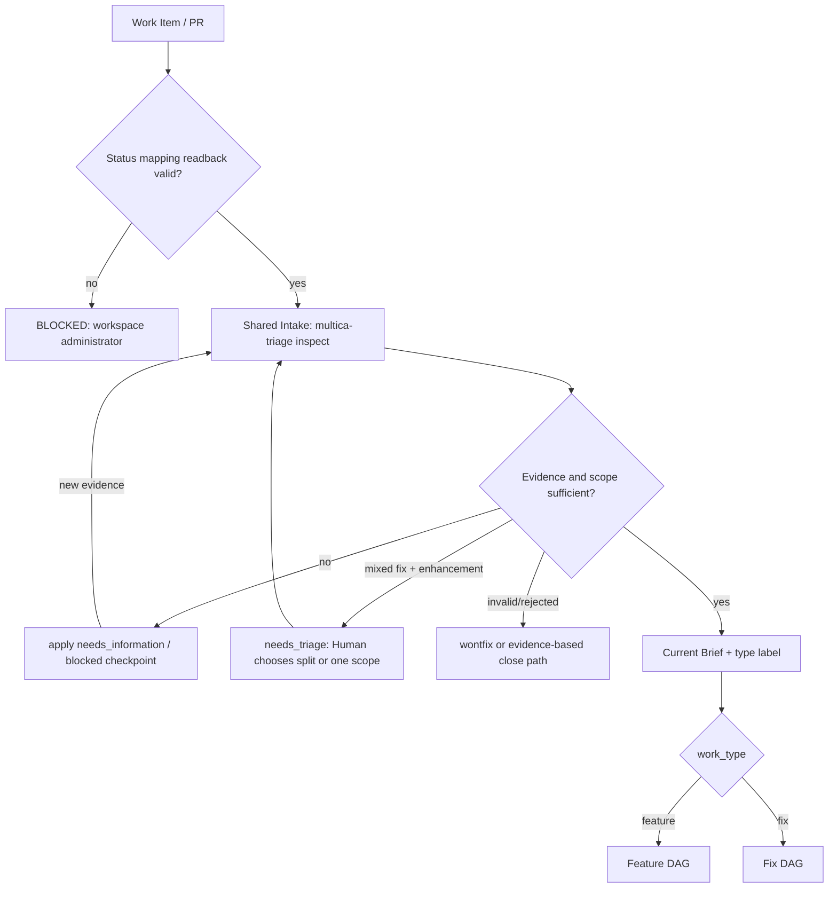
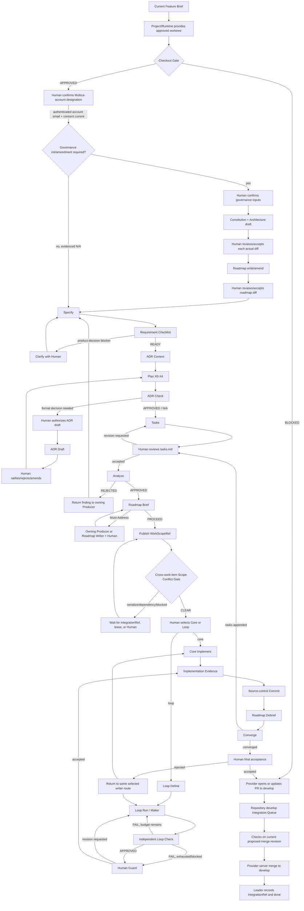
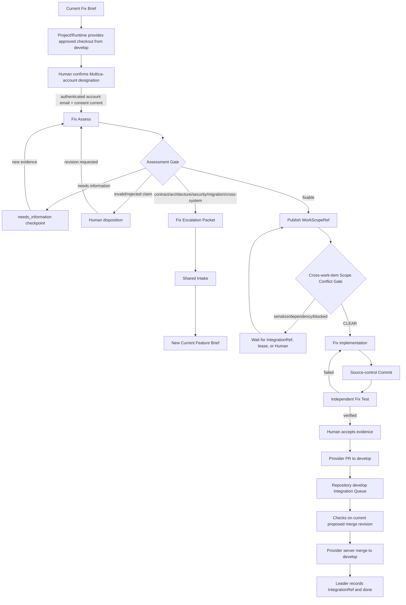

```yaml
coach_stage: W4
decision: ACCEPTED
source_project: capability-sample-robox-nexus
source_revision: git:d24411c8840bab361745c1ed7b41cf4b3a43b3e3+mapping:sha256:8ab657d28bbb9ac295dd7c3c12d6cf9e54b150a2b6f2b29d6af4b7ccdbe3b6b8
requirements_revision: sha256:3b6caab15839cd7489bf30c23f9598a45fa309a3ade7a6227597ab83cb237d94
input_artifacts:
  - analysis/w3-artifact-dependencies.md#sha256:f0f7748d0017b0424bd444654e923584d12abb2cc4980b6161a5c7d385d5caeb
  - contracts/handoff-gate-contracts.md#sha256:eef42b00a7630f5c801d87fe0bce9403fb09cea8f5625df7f72e0bcfc8c7cfbd
  - requirements/orchestration-requirements.md#sha256:3b6caab15839cd7489bf30c23f9598a45fa309a3ade7a6227597ab83cb237d94
decisions:
  default_worktree: false
  loop_eligible: true
  loop_isolation: none
  workflow_dags_accepted: true
open_blockers: []
supersedes: analysis/w4-feature-fix-dags.md#sha256:472d6279f1f7ed6bfbb474c2cc529c24aa29a6f4927a4ed2feef8a7b8fff51ca
```

# W4 Feature 与 Fix 工作流 DAG

## 1. 本步骤结论

- 所有工作先经过唯一 Shared Intake；完成 triage 后进入互相隔离的 Feature 或 Fix DAG。
- `workflow-leader` 只校验引用、持久化 Gate/Handoff/lease、路由和升级，不生产 Spec、Plan、Tasks、代码、测试或治理内容。
- Feature 使用批准的外层 worktree。Core/Loop 在首次源码修改前由 Human 选择恰好一个；Loop 固定 `isolation: none`。
- Constitution、Architecture、Architecture ADR、Roadmap 和每个 Tasks revision 均包含真实 Human 节点，不以 Agent 输出或 Gate PASS 替代。
- Fix 默认不进入 Feature 的治理/Spec/Plan/Tasks 链。需要改变合同、架构、安全边界、迁移或不可局部验证时，Fix DAG 终止并返回 Shared Intake 创建新的 Feature Brief。
- GitFlow branch、PR、merge、release tag 与 promotion 都由 provider/Human 执行。Feature/Fix 仅目标 `develop`；Release/Hotfix 的 `main` integration 和 required back-merge 通过 immutable receipts 记录。

## 2. 共享入口 DAG



### 共享节点合同

| ID | 启用条件 | Owner boundary | 输入引用 | Skill | 输出 | 成功证据 | REJECT/FAIL 返回 | BLOCKED 等待 | 并行 |
| --- | --- | --- | --- | --- | --- | --- | --- | --- | --- |
| `I1` | 任一 inspect/apply/dispatch 前 | Human 在 Multica Web 核对；`workflow-leader` 只记录已确认状态 | accepted status contract | `multica-cli` 只读；定义管理在 Web | `STATUS_CONTRACT_CONFIRMATION` | Human 明确同意五个 key/category；不要求证据或 readback ref | Human 发现 drift 后停止并由 administrator 修正 mapping | Web 权限/配置或 Human confirmation | 否 |
| `I2` | Work Item/PR 唯一可读 | `shared-intake` | WORK_ITEM、comments、runs、repo/PR evidence | `multica-triage` inspect | TRIAGE_EVIDENCE | 证据来源、revision、复现/需求差距完整 | `shared-intake` 重新调查 | reporter/maintainer/system | 可与纯只读 repo evidence 收集并行，写入前汇合 |
| `I3` | TRIAGE_EVIDENCE current | `shared-intake` recommendation；Human 处理异常范围 | TRIAGE_EVIDENCE | `multica-triage` | classification GateRecord | 恰好 fix/enhancement；异常 transition 有 Human 决定 | `shared-intake` | scope/evidence/Human split | 否 |
| `I4` | 分类充分或 Human override | `shared-intake` | classification gate、accepted clarification | `multica-triage` apply | CURRENT_BRIEF、type label、triage status | Brief 字段完整；恰好一个 type；write readback；无新 run | `shared-intake` | 缺 Brief 字段/权限 | 否 |
| `I5` | CURRENT_BRIEF current | `workflow-leader` | CURRENT_BRIEF@revision | 无内容 Skill；合同路由 | Feature 或 Fix HandoffRef | work_type 与 Brief/type 一致；唯一 downstream handoff | `shared-intake` | Brief stale/ambiguous | Feature 与其他 Fix work item 可并行；同一 work item 只选一条 |

状态边界：`ready_for_agent/backlog` 只表示 Brief 完整。只有显式 dispatch 才转到 built-in `todo` 并启动一个入口；记录当前执行状态时使用 `--no-start`。`ready_for_human/todo` 不分配 Agent/Squad。Gate 值不写入 Issue status。

## 3. Feature 总体 DAG



图中 `SAME` 不是允许切换 route：Leader 根据 `ImplementationRouteRef.route` 只激活 Core 或 Loop 的一条边，另一条必须为 `APPROVED_NA`。

## 4. Feature 节点合同
本节 `Owner boundary` 只使用 W5 manifest 的 exact `role_key`。每个会写 repository artifact 的节点都把 `conventional-commit` 作为同一 run 的尾部步骤：先固化 candidate，再创建 producer-owned `CommitRef.v2`，随后由 `commit-policy-reviewer` 独立只读验证；表格不为每个节点重复展开这两个机械步骤。

### 4.1 Checkout 与治理

| ID | 启用条件 | Owner boundary | 输入引用 | Skill | 输出 | 成功证据 | REJECT/FAIL 返回 | BLOCKED 等待 | 并行 |
| --- | --- | --- | --- | --- | --- | --- | --- | --- | --- |
| `F1` | Feature HandoffReady | Project/Runtime + Human | CURRENT_BRIEF、branch policy readback | 无 worktree Skill | CHECKOUT | CheckoutRef APPROVED；branch pattern/work item/owner、root/base/provider/provisioning receipt 唯一 | Project/Runtime | checkout、repo 权限、Human approval | 否；所有下游共享该 root |
| `F1-P` | CHECKOUT current | Human designation operator + `workflow-leader` | CURRENT_BRIEF、CHECKOUT、authenticated Multica account email、explicit consent | 无 | HUMAN_DESIGNATION | current `HumanDesignationRef`；email from `multica auth status` + consent | Human designation change | account email/consent/ledger | 否；初始化/重大调整在 governance-input 前，普通 Feature 在 Specify 前 |
| `F2` | checkout 与 HumanDesignationRef current | `workflow-leader` 只校验，Human 决定 amendment | CURRENT_BRIEF、HumanDesignationRef、current governance revisions | 无内容 Skill | governance-needed GateRecord | required 或带证据的 APPROVED_NA | `shared-intake` 或 governance owner | Human change-scope decision | 只读影响分析可并行，写入不得并行 |
| `F2-H` | 初始化或 amendment required；designation current | designated Human | HUMAN_DESIGNATION、authorized sources、目标、scope、current diffs | 无 | GOVERNANCE_INPUT_DECISION | account email matching、来源、范围、决定完整 | Human | 授权来源/范围 | 否 |
| `F2-C` | governance input accepted | `feature-governance-producer` | HUMAN_DESIGNATION、GOVERNANCE_INPUT_DECISION、repo evidence | `speckit-constitution` | CONSTITUTION、ARCHITECTURE | 两个 artifact revision 和实际 diff；无占位/越权事实 | 同一 Producer 修改 | source owner/Human evidence | 否；同一 Skill/共享 files |
| `F2-CH` | Constitution/Architecture drafts current | designated Human | 两个 artifact revisions + actual diffs | 无 | CONSTITUTION_ACCEPTANCE、ARCHITECTURE_ACCEPTANCE | 分别 ACCEPTED；Architecture 事实/推断/target/gap 被审阅 | `F2-C` | Human review | 两个 review 可独立记录，但未全部接受不汇合 |
| `F2-R` | governance accepted 且 Roadmap init/delta required | `feature-governance-producer` | accepted governance、Human roadmap input | `speckit-roadmap-write` | ROADMAP | ledger/version/diff 非破坏且可判定 | 同一 Governance Producer | Human delta/source | 不与其他 Roadmap writer 并行 |
| `F2-RH` | Roadmap draft current | Human Authority | ROADMAP@revision + actual diff | 无 | ROADMAP_ACCEPTANCE | Human ACCEPTED exact revision | `F2-R` | Human review | 否 |
| `F2-SYNC` | Human 请求全局 reconciliation 或已有 drift evidence | `feature-reviewer` | ROADMAP、spec inventory、ADR corpus | `speckit-roadmap-sync` | ROADMAP_SYNC_REPORT | findings 有 refs，report 唯一且只读 | owning Producer | ambiguous/missing evidence | 可与不写同一输入的只读检查并行；Must-Address 在相关 gate 前汇合 |

### 4.2 需求、设计与任务

| ID | 启用条件 | Owner boundary | 输入引用 | Skill | 输出 | 成功证据 | REJECT/FAIL 返回 | BLOCKED 等待 | 并行 |
| --- | --- | --- | --- | --- | --- | --- | --- | --- | --- |
| `F3` | checkout、HumanDesignationRef approved；governance ready/NA | `feature-requirement-producer` | CURRENT_BRIEF、CHECKOUT、HUMAN_DESIGNATION、accepted governance refs | `speckit-specify` | FEATURE_SPEC | stable refs、scope/AC/source provenance；无 unauthorized hook | Requirement Producer | sources/Brief；mandatory worktree hook 未禁用时 provider | 否；唯一 spec writer |
| `F4` | FEATURE_SPEC current；rule fragments available | `feature-requirement-reviewer` | FEATURE_SPEC、rule fragment revisions | `speckit-checklist` | REQUIREMENT_GATE | exact spec SHA、六 gates、PASS evidence 或 owned blocker | template blocker 回 Reviewer；product blocker 到 `F4-C`; source blocker 到 source owner | `REQUIREMENT_RULES_UNAVAILABLE`/evidence | 否；唯一 requirements gate writer |
| `F4-C` | product-decision blocker | `feature-requirement-producer` + Human | FEATURE_SPEC、REQUIREMENT_GATE blockers | `speckit-clarify` | CLARIFICATION_DECISION + new SPEC/GATE revisions | 每个答案 Human accepted，stable refs 同步 | 同一 Requirement Producer | Human product decision | 否；返回 F3/F4 重判 |
| `F5` | Requirement Gate READY | `feature-planning-producer` | accepted Architecture/ADR corpus、Feature paths | `speckit-adrkit-context` | ADR_CONTEXT | JSON 可读，paths/corpus revision 明确 | 同一 Planning Producer | adrkit/corpus | 可与 Plan 前纯 repository fact collection 并行，F6 前汇合 |
| `F6` | Requirement Gate READY；ADR context current | `feature-planning-producer` | FEATURE_SPEC、REQUIREMENT_GATE、accepted governance、ADR_CONTEXT、repo facts | `speckit-plan` | PLAN_BUNDLE | PLAN_OUTPUT_READY 派生；X0–X4、test/design refs、VAL paths 完整 | 同一 Planning Producer；治理冲突返 governance owner | source/tool/Human architecture decision | 一个 Plan owner；Skill 内部互不覆盖 lanes 可并行 |
| `F7` | PLAN_BUNDLE current | `feature-reviewer` | PLAN_BUNDLE、ADR_CONTEXT、corpus/snapshot | `speckit-adrkit-check` | ADR_CHECK | governing decisions verified；snapshot 缺失被明确限定 | Planning Producer 或 ADR owner | snapshot/tool/corpus | 否 |
| `F7-H` | ADR Check 证明正式决定缺口 | Human Authority | ADR finding、Plan、Architecture | 无 | ADR drafting authorization | Human 同意 title/scope/source | Planning Producer/Governance Producer | Human | 否 |
| `F7-D` | Human 授权 draft | `feature-governance-producer` | authorization、PLAN_BUNDLE | `speckit-adrkit-draft` | ADR_DRAFT | schema-valid、status=draft、ID/path 唯一 | 同一 Governance Producer | adrkit/plan | 否 |
| `F7-R` | ADR draft/amendment current | Human Authority | ADR revision + actual diff/options/tradeoffs | 无 | ADR_ACCEPTANCE | ratify/reject/revision request 明确 | `F7-D` 或 Planning Producer | Human decision | 否；接受后返回 Plan/Check 重判 |
| `F8` | PLAN_OUTPUT_READY；ADR gate accepted/NA | `feature-planning-producer` | PLAN_BUNDLE、FEATURE_SPEC | `speckit-tasks` | TASKS | task IDs/paths/deps/[P]/tests/final review 可执行 | 同一 Planning Producer | unresolved Plan inputs | 否；EXCLUSIVE_WRITE lease |
| `F9` | 每个新 TASKS revision | Human Authority | TASKS@revision + actual diff | 无 | TASKS_ACCEPTANCE | 覆盖、粒度、路径、依赖、并行、验证、blocker 明确接受 | `F8` | Human review | 否；READ_ONLY review |
| `F10` | TASKS_ACCEPTANCE current | `feature-reviewer` | accepted governance、SPEC、GATE、PLAN、TASKS | `speckit-analyze` | ANALYZE_REPORT | 无 CRITICAL/coverage/constitution blockers | finding 对应的唯一 Producer | missing/stale artifact | 只读；不得与仍在写上游的节点并行 |
| `F11` | Analyze APPROVED | `feature-reviewer` | ROADMAP、ADRs、SPEC、ANALYZE_REPORT | `speckit-roadmap-brief` | ROADMAP_BRIEF_REPORT | 唯一 entry；PROCEED；无 Must-Address | Governance、Planning 或 Requirement Producer，按 finding ownership | ambiguous entry/Human roadmap delta | 否；report-only |
| `F11-S` | Roadmap Brief PROCEED | owning Producer + `workflow-leader` validation | CHECKOUT、TASKS_ACCEPTANCE、approved paths/resources | 无内容 Skill | WORK_SCOPE | current `WorkScopeRef`；路径、logical resources、dynamic-path state 完整 | Tasks/Scope owner | unresolved paths/resources | 可与其他 Work Item scope evaluation 并行 |
| `F11-G` | WorkScope current | `workflow-leader` + provider scope registry；Human 处理非机械取舍 | current scope、其他 active scopes、resource leases | 无内容 Skill | SCOPE_CONFLICT_GATE | `CLEAR`，或明确 SERIALIZE/DEPENDS_ON/HUMAN/BLOCKED owner | scope owner/Human | conflicting integration/lease/decision | 只有 CLEAR 才进入 route |

### 4.3 实现、Loop、Debrief 与收敛

| ID | 启用条件 | Owner boundary | 输入引用 | Skill | 输出 | 成功证据 | REJECT/FAIL 返回 | BLOCKED 等待 | 并行 |
| --- | --- | --- | --- | --- | --- | --- | --- | --- | --- |
| `F12` | Roadmap Brief PROCEED；首次源码写前 | Human Authority + `workflow-leader` persist | CHECKOUT、TASKS_ACCEPTANCE、ANALYZE、ROADMAP_BRIEF | 无 | IMPLEMENTATION_ROUTE | HumanDecisionRef；恰好 core/loop；locked；Loop isolation none | Human | route decision/config | 否 |
| `F13-C` | route=core only | `feature-core-maker` | route、CHECKOUT、SPEC、PLAN、TASKS | `speckit-implement` | CORE_CHANGESET | task-level diff/test evidence；只写批准 scope | 同一 Core Maker；合同变化返 Shared Intake | tool/env/permission/Human risk | 可执行 TASKS `[P]` 的不相交任务，但同一 artifact lease 不并行 |
| `F13-LD` | route=loop only | `feature-loop-maker` | route、CHECKOUT、TASKS | `speckit-loop-define` | LOOP_CONTRACT | criteria/budget/roles/tools/state/isolation=none 完整 | 同一 Loop Maker | Human criteria/config | 否 |
| `F13-LR` | valid Loop contract；budget remains | `feature-loop-maker` | LOOP_CONTRACT、CHECKOUT、latest checker feedback | `speckit-loop-run` | LOOP_ITERATION | iteration/diff/test/stop evidence append-only | 同一 Loop Maker | env/tool/permission | 不与 Checker 或 Core 并行 |
| `F13-LC` | immutable latest iteration | `feature-loop-checker` | LOOP_ITERATION、LOOP_CONTRACT | `speckit-loop-check` | LOOP_CHECK_VERDICT | independent identity；逐 criterion PASS/FAIL；uncertain=FAIL | Loop Maker | checker runtime/evidence | 与 Maker 串行交替 |
| `F13-LG` | checker PASS、budget exhausted、risk/debt trigger | `feature-loop-guard` 支持 Human Authority | checker verdict、changes、debt、budget | `speckit-loop-guard` | LOOP_GUARD_DECISION | Human sign-off + no blocking debt 才 accepted | Loop Maker 或 Human stop | Human understanding/risk decision | 否 |
| `F14` | Core evidence current，或 Loop checker+guard accepted | `workflow-leader` 只归一化 refs | route-specific evidence | 无内容 Skill | IMPLEMENTATION_EVIDENCE | 恰好一个 route source；checkout/revisions 一致 | selected writer/verifier | stale/partial evidence | 否 |
| `F14-C` | selected Maker 的 producer-owned COMMIT current | `commit-policy-reviewer` | CHECKOUT、approved scope、implementation evidence、ChangesetCandidateRef、CommitRef.v2、commit-policy readback | `conventional-commit` validator only | COMMIT_POLICY_VERDICT | immutable CommitRef；producer run identity、candidate diff/path 与 SHA 一致；Conventional Commit Work-Item footer 解析为 current work item | exact selected Maker | dirty work、hook/validator/permission、branch/parent drift | 否；只读，不 commit/push/merge |
| `F15` | maker commit verdict VERIFIED | `feature-reviewer` | ROADMAP、SPEC、ADRs、current CommitRef、implementation evidence | `speckit-roadmap-debrief` + `conventional-commit` | ROADMAP_DEBRIEF_REPORT + producer-owned CommitRef.v2 | outcome/scope/drift 有 evidence；只提议不改 ledger；本 run report commit 通过 policy verdict | code finding 到 selected writer；roadmap finding 到 Writer+Human；spec finding 到 Requirement Producer | missing evidence/ambiguous entry | 否 |
| `F16` | Debrief commit verdict VERIFIED | `feature-convergence-reviewer` | SPEC、PLAN、TASKS、current CommitRef、Debrief | `speckit-converge` + `conventional-commit` | CONVERGENCE_RESULT；可能 new TASKS revision + producer-owned CommitRef.v2 | converged 或只 append Convergence phase；本 run commit 通过 policy verdict；不改代码 | tasks_appended 返回 F9；输入缺陷返 owner | verification/tool/evidence | 否；APPEND_ONLY lease |
| `F17` | Convergence commit verdict VERIFIED | Human Authority | current commit range、implementation、Debrief、Convergence、risks | 无 | FINAL_ACCEPTANCE | Human 接受 exact revisions/evidence | 同一 selected writer route；不得切 route | Human decision/manual evidence | 否 |
| `F18-Q` | FINAL_ACCEPTANCE accepted、PR current | repository provider + Human | current CommitRef、PR source head、latest target revision、ScopeConflictGate | 无 | INTEGRATION_ATTEMPT | 同一 repository+target 只有一个 active evaluating/merging attempt；proposed-merge checks 绑定 exact source/target | Provider/Human | queue、target drift、scope conflict、CI | 不同 repository 可并行；同一 target 串行 |
| `F18` | INTEGRATION_ATTEMPT READY | repository provider + Human | current attempt、八个 checks、Human/provider approvals、optional MergeResolutionRef | 无 | `INTEGRATION_REF` | target=`develop`、source/target revisions、server merge commit、checks/approval/readback 完整 | Provider/Human 或 owning Maker | provider/CI/conflict/merge queue | Agent 不 push/merge |

## 5. Feature Gate 表

| Gate | 必需分支 | APPROVED 条件 | REJECTED 返回 | BLOCKED 等待 |
| --- | --- | --- | --- | --- |
| `FG0_BRIEF` | triage | current Feature Brief 完整且 work_type=feature | Shared Intake | reporter/maintainer evidence |
| `FG1_CHECKOUT` | Project/Runtime + Human | CheckoutRef APPROVED、唯一 root | Project/Runtime | repo/permission/Human |
| `FG1_HUMAN_DESIGNATION` | operator-local HumanDesignationRef current；authenticated account email + explicit consent | Human/Leader | account login/consent/ledger |
| `FG2_GOVERNANCE` | N/A 或完整 Human governance branch | 无变更有客观 N/A；有变更则 Constitution/Architecture/Roadmap 分别 Human accepted | 对应 Governance Producer | Human/source owner |
| `FG3_REQUIREMENTS` | Specify + Checklist + conditional Clarify | Requirement Gate READY、current spec SHA | Requirement Producer/Reviewer | product/source/template owner |
| `FG4_PLAN_ADR` | ADR Context + Plan + ADR Check + conditional ADR Human branch | PLAN_OUTPUT_READY、ADR approved/NA | Planner/ADR Producer | Human/adrkit/snapshot/source |
| `FG5_TASKS` | Tasks + Human Review | current Tasks revision Human accepted | Task Planner | Human |
| `FG6_ANALYZE` | Analyze | 无 blocking findings | finding owner | stale/missing input |
| `FG7_ROADMAP_BRIEF` | Brief | PROCEED 且无 Must-Address | Roadmap/Spec/Plan owner | Human roadmap decision |
| `FG8_SCOPE` | current WorkScope + cross-item comparison | `ScopeConflictGate=CLEAR`；否则按指定 dependency/lease/Human 路由等待 | scope owner/Human | scope registry、resource lease、integration dependency |
| `FG8_ROUTE` | Human route | current locked core/loop route；Loop isolation none | Human | config/decision |
| `FG9_IMPLEMENTATION` | core 或完整 Loop bundle | Core evidence current；或 Loop checker approved + guard accepted | selected writer | env/tool/Human guard |
| `FG9_COMMIT` | selected repository writer + `commit-policy-reviewer` | producer-owned current CommitRef 的 lineage、run identity、candidate mapping、Conventional Commit 与 Work-Item footer 全部有效且 verdict VERIFIED | exact selected writer | provider hook/validator/permission |
| `FG10_DEBRIEF` | Roadmap Debrief | report current，Must-Address 已路由 | finding owner | evidence/Human roadmap delta |
| `FG11_CONVERGENCE` | Converge | converged；若 tasks appended 则先完成新 F9–F16 cycle | same route writer/Task Planner | verification evidence |
| `FG12_HUMAN_FINAL` | Human | current CommitRef 与 exact revisions accepted | same selected route | Human decision |
| `FG13_INTEGRATION` | provider queue | current IntegrationAttempt source/target、ScopeConflictGate、proposed-merge checks、approval 均 current；provider server merge 完成 | provider/Human | queue/target drift/CI/conflict |

## 6. Fix DAG



### Fix 节点合同

| ID | 启用条件 | Owner boundary | 输入引用 | Skill | 输出 | 成功证据 | REJECT/FAIL 返回 | BLOCKED 等待 | 并行 |
| --- | --- | --- | --- | --- | --- | --- | --- | --- |
| `X0-P` | current Fix Brief | Human designation operator + `workflow-leader` | CURRENT_BRIEF、authenticated Multica account email、explicit consent | 无 | HUMAN_DESIGNATION | current `HumanDesignationRef`；account email/consent current | Human designation change | account/consent/ledger | 否；必须先于 Fix Assess |
| `X1` | current Fix Brief、approved CheckoutRef 与 HumanDesignationRef | `fix-assessor` | CURRENT_BRIEF、HUMAN_DESIGNATION、code/evidence/reproduction | `speckit-bug-assess` + `conventional-commit` | FIX_ASSESSMENT + producer-owned CommitRef.v2 | symptom/expected/actual/root cause/severity/impact/remediation/verdict 完整；assessment commit 通过 policy verdict | Fix Assessor 重查 | reproduction/source/reporter | 只读 evidence collection 可并行；单一 assessment writer |
| `X2` | assessment current | `workflow-leader` 路由，不改 assessment | FIX_ASSESSMENT | 无内容 Skill | FIX_ROUTE_GATE | fixable/needs-information/invalid/feature-escalation 唯一且有 evidence | Fix Assessor | Human/外部信息 | 否 |
| `X2-S` | assessment current且 verdict=fixable | Fix Assessor 声明、Leader 校验 | assessment、CheckoutRef、approved paths/resources | 无内容 Skill | WORK_SCOPE | current `WorkScopeRef` 完整且 dynamic paths resolved | Fix Assessor | scope/evidence | 可与其他 Work Item scope evaluation 并行 |
| `X2-G` | WorkScope current | `workflow-leader` + provider scope registry；Human 处理冲突优先级 | current scope、active scopes、resource leases | 无内容 Skill | SCOPE_CONFLICT_GATE | CLEAR 或明确 wait/dependency/Human owner | Assessor/Human | conflicting integration/lease | 只有 CLEAR 才进入 Maker |
| `X3-E` | verdict=feature-escalation | `fix-assessor` 产 evidence；Leader 终止 Fix | assessment + evidence | 无新增 Skill；返回 `multica-triage` | FIX_ESCALATION_PACKET、新 Feature intake handoff | 合同/架构/跨系统/迁移/安全/不可逆原因明确；Fix writer 未继续 | Shared Intake | Human classification/split | 否 |
| `X3-F` | verdict=fixable | `fix-maker` | assessment、approved repo context | `speckit-bug-fix` + `conventional-commit` | FIX_CHANGESET + producer-owned CommitRef.v2 | 最小 diff、tests、deviations、targeted checks；本 run commit current；assessment 偏差即停 | Fix Assessor 或同一 Maker | tool/env/permission/risk | 不与 Test 并行；同一 code path 单 writer |
| `X3-C` | Maker CommitRef current | `commit-policy-reviewer` | CHECKOUT、approved scope、fix changeset、ChangesetCandidateRef、CommitRef.v2、commit-policy readback | `conventional-commit` validator only | COMMIT_POLICY_VERDICT | current CommitRef 的 SHA/run/diff/footer/work item 全部一致，verdict VERIFIED | Fix Maker | hook/validator/permission/dirty work | 否；只读，不 commit/push/merge |
| `X4` | maker commit verdict VERIFIED | `fix-verifier` | assessment、CommitRef、fix changeset、reproduction | `speckit-bug-test` + `conventional-commit` | FIX_TEST_REPORT + producer-owned CommitRef.v2 | 原始症状实际重放；regression；verified/partial/failed 真实；report commit 通过 policy verdict | failed 到 Fix Maker；assessment 错误到 Assessor | target env/manual evidence | 与 Maker 串行；Verifier 不改源码 |
| `X5` | test verified 且 report commit verdict VERIFIED，或 partial/risk 需裁决 | Human Authority | current commit range、assessment/fix/test exact revisions | 无 | FIX_FINAL_ACCEPTANCE | verified evidence accepted，或 partial/risk 有显式决定 | Maker/Assessor | Human/manual evidence | 否 |
| `X6-Q` | Human accepted、PR current | repository provider + Human | current CommitRef、PR source head、latest develop revision、ScopeConflictGate | 无 | INTEGRATION_ATTEMPT | queue 原子、proposed-merge checks 绑定 exact revisions | provider/Human | queue/target drift/CI/conflict | 同一 develop target 串行 |
| `X6` | INTEGRATION_ATTEMPT READY | repository provider + Human | current attempt、checks、approval、optional MergeResolutionRef | 无 | INTEGRATION_REF | PR target=`develop`、server merge/check/approval readback | provider/Human 或 Fix owner | provider/CI/semantic conflict | Agent 不 push/merge |
| `X7` | IntegrationRef current | `workflow-leader` | all current Fix gates | `multica-cli` recording-only | Issue lifecycle readback | status/ref write readback；无新重复 run | Leader 记录真实 partial state | provider permission | 否 |

### Fix Gates

| Gate | APPROVED 条件 | REJECTED 返回 | BLOCKED 等待 |
| --- | --- | --- | --- |
| `XG0_BRIEF` | current Brief 完整且 work_type=fix | Shared Intake | reproduction/expected behavior |
| `XG0_HUMAN_DESIGNATION` | current HumanDesignationRef：authenticated account email + explicit consent | Human/Leader | account email、consent 或 ledger |
| `XG1_ASSESSMENT` | root cause 与影响面可解释、verdict 唯一 | Fix Assessor | reporter/system/Human |
| `XG2_FIX` | 最小 changeset + tests + local evidence，未改变合同 | Fix Maker；改变合同则 escalation | tool/env/permission |
| `XG2_SCOPE` | current WorkScope 且 `ScopeConflictGate=CLEAR` | Assessor/Human | scope registry、lease、dependency |
| `XG2_COMMIT` | current CommitRef、candidate mapping、Conventional Commit 和 Work-Item footer 有效 | Fix Maker/Committer | hook/validator/permission |
| `XG3_TEST` | 原始症状不再复现且 critical regression 通过 | Fix Maker/Assessor | target/manual evidence |
| `XG4_HUMAN_FINAL` | Human 接受 current CommitRef 与 exact test/fix revisions | Maker/Assessor | Human decision |
| `XG5_INTEGRATION` | provider merged current PR head to `develop` with checks/approval receipts | provider/Human | CI/merge queue/approval |

## 7. Fix 升级为 Feature 的硬切点

任一条件触发 `feature-escalation`：

- 改变产品规则、API 语义、Feature Spec 或 acceptance contract；
- 根因需要 Architecture/ADR amendment，最小局部修复不可接受；
- 跨多个系统且影响无法局部验证；
- 数据迁移、安全/权限边界或不可逆操作；
- assessment 不能证明是实现偏离既有有效合同。

切换规则：

1. 终止 Fix write lease；Fix Maker 不再修改代码。
2. 保留 assessment、reproduction 和 evidence revisions。
3. Shared Intake 重新分类并创建新的 current Feature Brief，引用 `FIX_ESCALATION_PACKET`。
4. 新 Feature 从 `FG0_BRIEF` 开始；不能跳过 Checkout、Spec、Requirement Gate、Plan 或 Human governance gates。
5. Fix Producer/Verifier 不作为 Feature Producer/Verifier 复用；相同 runtime 不是合并理由。

## 8. 并行与汇合规则

- 同一 Work Item 的全部 writer 节点命中同一 Runtime，但每个 run 使用独立 Runtime task branch/worktree，并按 DAG 串行；provider 通过 stable integration branch 衔接 verified commits。跨 Work Item 可在同一 repository 的独立 worktree 并行，但 current WorkScope、`ScopeConflictGate=CLEAR` 与 resource leases 必须 current。
- 一个 Agent run 内部只有在输入 revisions 冻结、输出路径不重叠且任务被 Tasks 标记 `[P]` 时才可并行计算；不得由此并发同一 Work Item 的 repository writer runs。
- fan-out 必须为每个分支创建独立 HandoffRef；汇合 GateRecord 逐分支记录，不使用阶段级模糊 PASS。
- 已 APPROVED 分支在另一分支 BLOCKED 时不返工，除非其输入 revision 被修改。
- Constitution/Architecture、Roadmap、同一 ADR、依赖锁、migration 序列、共享 API/schema 和同一 target integration 使用 repository-global resource lease；独立 worktree 不豁免。
- Spec、Requirement Gate、Plan、Tasks 和代码/report writers 在同一 Work Item 内不并发。
- Loop Maker/Checker 串行交替；Core/Loop 永不并行。
- Fix Assess/Implementation/Test 在一个 Work Item 内串行；只读 evidence gathering 仅可作为单个 run 内的独立计算并行。
- 同一 repository target 的 IntegrationAttempt 串行，不同 repository 可并行。target 前进只重判 integration 默认范围；scope/dependency/governance overlap 或验证失败才扩大 stale。

汇合示例：

```yaml
gate_id: gate:<work-item>:feature-plan-inputs:1
decision: BLOCKED
checks:
  - check_id: requirement-gate
    result: PASS
  - check_id: adr-context
    result: PASS
  - check_id: repository-evidence
    result: BLOCKED
    reason: missing authorized source revision
blocker_refs:
  - source-owner:<opaque-ref>
```

只等待 `repository-evidence`；不重跑未失效的 Requirement Gate 与 ADR Context。

## 9. W4 验收检查

| 检查 | 结果 |
| --- | --- |
| Shared Intake 后 Feature/Fix DAG 明确分离 | PASS |
| 每个节点声明条件、owner、输入、Skill、输出、证据、失败、阻塞、并行 | PASS |
| Constitution/Architecture/ADR/Roadmap/Tasks 有真实 Human 节点 | PASS |
| Feature 顺序符合 accepted tutorial 与 artifacts | PASS |
| Fix 保持轻量，并有明确 Feature escalation hard cut | PASS |
| Core/Loop 在首次写入前恰好选择一条 | PASS |
| GitFlow Feature/Fix target=`develop`；Release/Hotfix promotion 只由 provider/Human 记录 | PASS |
| 未伪造 deployment/live provider 节点 | PASS |

W4 已由 Human 接受。当前 revision 成为 W5–W8 的强制输入。
