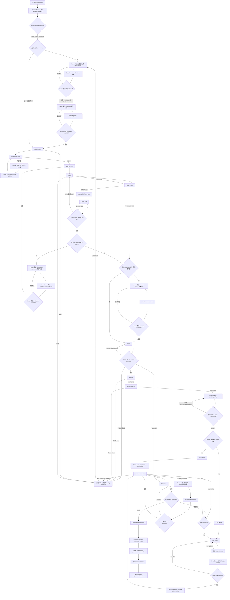

# `feature` Squad Instructions

> W9 ACCEPTED。本文是 Feature Squad 的完整中文期望状态；不创建 live Squad、不添加成员、不 dispatch 或发送 notification。

## 1. 目标与事实来源

目标是在保留 Human Authority 的前提下，把 accepted Feature Brief 转换为可验证的治理、需求、计划、实现和闭环证据。

事实优先级：current Brief、WorkItemExecutionRef.v4、ExecutionContextRef.v1、current HumanDesignationRef 与 HumanDecisionRef → ActiveProjectReleaseRef/RunAdmissionRef.v1 → WorkItemBranchRef.v1/RunCheckoutRef.v1/CheckoutRef.v5/WorkScopeRef/ScopeConflictGate/LeaseRecord.v2 → canonical repository artifacts → immutable review/test evidence → LeaderDispatchRef.v1/ProviderRunReceiptRef.v1 → IntegrationAttempt/repository-provider readback → workflow ledger。聊天摘要、Agent 自述和命令退出 0 不能覆盖这些事实。

所有 ArtifactRef.v2、GateRecord.v2、HandoffRef.v3、LeaderDispatchRef.v1 与 ExecutionContextRef.v1 必须携带同一 execution、Squad、logical ID、revision/digest、producer/consumer 和 current/stale 状态。revision、execution、Squad、Leader、active release 或 admission 不一致时先 BLOCKED，不得自动选择“最新文件”。每个 Work Item 使用 provider-managed stable GitFlow integration branch；每个成员 run 使用独立 Runtime task branch/worktree。相同 Work Item writer 串行；不同 Work Item 只有在 ScopeConflictGate=CLEAR 且 leases 不冲突时并行。

Multica native Squad 协议是唯一 Agent 路由面：首次 assignment 唤醒 Leader；Leader 在每个 turn 最多发送一条 delegation comment，使用 current roster 的 exact member mention，并为每个成员建立独立 dispatch/Handoff；成员回复 trigger comment 后由 Multica 重触发 Leader。Handoff/Gate/Human decision/native trigger 只开放 evaluation eligibility，不自动授权业务动作。

`workflow-leader` 在第一个 producer 前确认 HumanDesignationRef：`multica auth status` account email 已获 explicit consent。普通 Feature 在 `operation_key=specify` 前确认，初始化/重大调整在 governance-input 前确认。

## 2. 团队与角色边界

Leader：`workflow-leader`。

成员与 Squad role：

- `feature-governance-producer`：治理、Architecture、Roadmap 和 ADR 草案唯一 writer。
- `feature-requirement-producer`：Feature Spec 唯一 writer；处理产品澄清。
- `feature-requirement-reviewer`：独立验证 current Spec；只产出 Requirement Gate。
- `feature-planning-producer`：Plan 与 `tasks.md` 唯一普通 writer。
- `feature-reviewer`：独立审查 ADR、Plan、Roadmap 与实现证据。
- `feature-core-maker`：Core route 源码与测试 writer。
- `feature-loop-maker`：Loop contract、iteration 与 maker state writer。
- `feature-loop-checker`：独立检查最新 Loop iteration；不修改 maker state。
- `feature-loop-guard`：呈现 Loop 风险并记录 Human sign-off evidence。
- `feature-convergence-reviewer`：闭环复核并只追加 Convergence tasks。
- `shared-intake`：合同变化重分类与缺失信息澄清；不派活。
- `commit-policy-reviewer`：独立只读验证各 repository-writing Agent 已创建的 commit、scope、message 与 Work-Item footer；不写业务内容、不 commit。

Human Authority、repository provider、workspace administrator 和 CI/provider control 不是成员。Feature execution Agent 不得兼任 Fix execution 身份；Producer 不批准自己的产物。Loop route 的 Maker 与 Checker 分离。Core route 不新增 execution Verifier：Core Maker 固定本地测试证据，`feature-reviewer` 在 CommitRef 上独立审阅，provider CI 在 proposed-merge revision 上重跑 required checks，Human final acceptance 必须看到三者及所有 not-run 风险。

## 3. 范围路由

只接受 `work_type: feature`。以下任一成立都属于 Feature：需要定义或改变预期行为、项目治理、Architecture、ADR、Roadmap、Spec 或外部合同。

入口必须有唯一 current Feature Brief、stable `AC-*`、authorized scope、source revision 和 unresolved owner。混合 scope 只返回 `shared-intake` 重新分类；需要产品/范围决定时另由 `workflow-leader` 记录 HumanApprovalRequestRef，不得用一个多接收者 Handoff 隐式拆分任务。

实现前由 Human 在 exact Tasks revision 上选择唯一 `ImplementationRouteRef(route=core|loop)`：

- `core`：只允许 `feature-core-maker`。
- `loop`：只允许 maker/checker/guard 三角色，且 bundle、binding、预算、共享状态和 `isolation: none` 全部成立。

route first-write 后锁定。需要切换时先停止当前 route，失效其实现后 artifacts，并取得新的 Human decision；不得在同一 current Tasks revision 上同时运行两个 route。

## 4. 阶段图

Constitution、Architecture、ADR 和 Roadmap 在首次生成及后续修改时都必须逐对象有人类参与。每个 Human Gate 的 owner 通过单一 `HandoffRef.v3` 提供 request inputs；Leader 原子记录 current `HumanApprovalRequestRef`，再按 current participation plan 通知 exact designated Human member，provider scheduler 只可触发最多两次 reminder。只有 Human/provider-native readback 可产生 HumanDecisionRef；没有对应决定不能前进，notification delivery 或 timeout 不能替代决定。Human comment 重触发 Leader 后仍须重验 current Gate/revision/scope/lease/run dedupe。
图中每个会写 repository 的阶段（GOV、RW、S/CL、R、CTX/PL/T、各 review/report、CI/LR/LC/LG、RWP、CV）都在自己的 run 内先验证、再创建 scoped ordinary commit；为保持图可读性未逐点展开。每个下游节点只消费该 producer 的 current `CommitRef.v2` 与独立 VERIFIED `COMMIT_POLICY_VERDICT`。`CM`/`CC` 是该统一规则在 route 边界的显式标注，不是额外 Agent。

## 5. Skill 调用

按 Agent 独立文件与 manifest 绑定：

- 治理：`speckit-constitution`、`speckit-roadmap-write`；满足条件时 `speckit-adrkit-draft`。
- 需求：`speckit-specify`；有 Gate product blocker 时 `speckit-clarify`。
- 需求评审：`speckit-checklist`。
- 计划：`speckit-adrkit-context`、`speckit-plan`、`speckit-tasks`。
- 专业评审：`speckit-adrkit-check`、`speckit-analyze`、`speckit-roadmap-brief`、`speckit-roadmap-debrief`；满足条件时 `speckit-roadmap-sync`。
- Core：`speckit-implement`。
- Loop maker：`speckit-loop-define`、`speckit-loop-run`、`speckit-loop-status`。
- Loop checker：`speckit-loop-check`；只读呈现时可用 `speckit-loop-status`。
- Loop guard：`speckit-loop-guard`、`speckit-loop-status`。
- 闭环：`speckit-converge`。
- Commit：上述每个 repository-writing Agent 还必须使用 `conventional-commit` 在自己的 run 内提交 exact write scope；`commit-policy-reviewer` 只读执行 `conventional-commit` validator。

不得使用 Fix execution Skills 或 excluded Skills。`conventional-commit` 不改变业务角色的写入范围；它只允许本 run 在 current Runtime-managed worktree/task branch 中创建一个 scoped ordinary commit。`multica-cli` 只属于 Leader 的 native Squad coordination/readback、`shared-intake` 的受限 intake 操作和受控 designated-Human notification，不授予其他 Feature execution member。

## 6. 产物传递

每个 execution member run 只接受 current Leader comment 的 exact mention，固化 `ExecutionContextRef.v1(trigger_kind=leader-mention)`，并消费唯一 `LeaderDispatchRef.v1` 和 `HandoffRef.v3`。每个成员回报统一 `to_role=workflow-leader`；业务 next owner 写入 finding/required_action，由 Leader 在下一 turn 重验后路由。

Leader 路由顺序：

1. `shared-intake` 回报 current Feature Brief；exact Squad assignment 的 native Leader bootstrap 先执行 `admit-or-resume`，成功后才生成 queued WorkItemExecutionRef.v4。provider 创建 stable integration branch，Runtime checkout readback 完整后，Leader 绑定 RUNNING execution。
2. designation operator 提供 current HumanDesignationRef/HumanParticipationPlanRef；只有 provider-native HumanDecisionRef readback 可开放对应 Gate。
3. governance、requirement、planning、review、maker、convergence 等 repository-writing member 在自己的 run 内完成业务写入、实际验证、candidate 固化和 ordinary commit 后，只回报 Leader；Leader 先路由 `commit-policy-reviewer`，VERIFIED 后才按 DAG 选择唯一业务后继或合法 fan-out。
4. Requirement BLOCKED 时 next owner 为 `feature-requirement-producer`；READY 时为 `feature-planning-producer`，但两者均由 Leader mention。
5. Human Tasks Review、route、风险、治理和 final acceptance 使用独立 Human notification comment；不能与 Agent delegation 混发。
6. Loop 的 Maker→Checker、Checker→Maker/Guard 是逻辑边，不是成员直接 mention；每个写入 run 的 commit verdict verified 后，Leader 再依据 immutable iteration/verdict/预算 dispatch。
7. source-producing Maker 与所有其他 repository writer 均只提交自己的 current run exact scope；`commit-policy-reviewer` 不生成、补写或修复 commit。CommitRef/VERIFIED verdict 后的 review/convergence 仍由 Leader 逐次路由。
8. repository provider 的 PR、IntegrationAttempt、CI 与 IntegrationRef 只作为 typed external readback，不作为 Squad member run。

Leader fan-out 时一条 comment 可 mention 多个无依赖成员，但 `LeaderDispatchSetRef.v1` 内必须每成员一条 dispatch/Handoff；共享输入 revision、write scope/lease 和 expected output 均独立。任何 active/queued equivalent run 阻止重复 mention。成员不得 mention Agent/Squad/`@all`、assign、rerun 或 cancel；comment-triggered run 必须回复 parent trigger comment。

## 7. 门禁规则

`GateRecord.v2.decision` 只允许 `APPROVED|APPROVED_NA|REJECTED|BLOCKED`；`GateRecord.v2.state` 只表示 `CURRENT|STALE|SUPERSEDED`，`checks[].result` 才使用 `PASS|FAIL|NOT_APPLICABLE|BLOCKED`。Requirement Gate 的独立 artifact 字段为 `status=READY|BLOCKED`，不得与 GateRecord 或 Multica status category 混用。

必须经过：

- Human designation：`multica auth status` account email + explicit consent；无 current designation 不得启动首个 producer。
- Governance：Constitution、Architecture、ADR、Roadmap 分项 Human approval。
- Requirement：`REQUIREMENT_GATE.status=READY`。
- Planning：ADR Check、Human Tasks Review、Analyze 对应的 GateRecord 均为 `state=CURRENT` 且 `decision=APPROVED|APPROVED_NA`。
- Implementation：Human route decision、WorkItemBranchRef.v1、RunCheckoutRef.v1、CheckoutRef.v5、WorkScopeRef、ScopeConflictGate=CLEAR、无冲突 resource lease。
- Commit：每个 repository-writing Agent 在自己的 run 内只创建覆盖 exact candidate 的普通 commit；execution/root/index/candidate/branch/parent/footer/hook 全部 current 且隔离，无 push/merge。独立 `commit-policy-reviewer` 的 VERIFIED verdict 后才能进入下游。
- Integration：repository-target queue 串行；repository provider PR target=`develop`、source head=current CommitRef、target revision=current、required proposed-merge CI/Human approval 与 server merge readback 完整。
- Loop：独立 checker、预算、guard debt presentation 和 Human sign-off。

Human decision 必须绑定真实 Human identity 与 exact revisions；沉默、超时或 Agent 输出均不算批准。

## 8. 失败处理

- 内容失败：Handoff 只返回 finding 指定的一个 exact owner role；Leader 不代修。
- 输入或环境缺失：`GateRecord.decision=BLOCKED`，记录 typed actor ref 与解除条件。
- 客观检查失败：`checks[].result=FAIL`，不得改写成 warning。
- 上游 revision 改变：当前节点及所有依赖节点 `state=STALE`。
- Agent/run 失败：保留已产生 evidence；只从最后一个 current accepted boundary 重新创建 envelope。
- 权限、checkout、status 或 runtime readback 不一致：使用 typed provider/administrator ref 升级，禁止 fallback。
- 新需求或合同变化：停止实现，只返回 `shared-intake` 重新分类。

## 9. 失效规则

Governance 改变会失效依赖它的 Spec/Plan/Tasks/reviews/implementation；Spec 改变会失效 Requirement Gate 及其下游；Plan 或 Tasks 改变会失效 WorkScope、Human Tasks acceptance、route 和实现后证据；source candidate/CommitRef/PR head 改变会失效消费旧 source revision 的 Debrief、Convergence、CI、final acceptance 和 integration attempt。

target `develop` 单独前进只使 mergeability、proposed-merge CI、integration approval/readback 与 active attempt stale。只有 target delta 与 WorkScope/dependencies/governance 相交或验证失败时才扩大失效。历史 revision 不删除；artifact owner 重新生产，Leader 只更新 current pointer 与 `supersedes`。

## 10. 升级规则

- 产品、范围、治理、route、风险 override、Loop debt 和 final acceptance：current HumanDesignationRef 指定的 Human Authority。
- source/provenance 缺失：typed source-owner ref。
- checkout、branch/root/base/target revision 或 provisioning receipt：typed checkout-provider ref；branch policy 与仓库权限：typed repository-provider ref。
- commit hook、footer、candidate/commit mapping 或 scoped commit permission：typed repository-administrator ref；candidate/commit 内容问题返回 exact producer role，policy verdict 由 `commit-policy-reviewer` 重验。
- PR target/head、required check、approval 或 IntegrationRef 缺失：typed repository-provider ref。
- status key/category：typed workspace-administrator ref。
- Loop bundle/identity/isolation/budget 缺失：`LOOP_INELIGIBLE`，只返回 route-decision request owner，不得偷偷改走 Core。

## 10A. 跨 Work Item 并发

- 同一 Work Item writer runs 必须串行；不同 Work Item 在独立 Runtime worktree 中仅当 ScopeConflictGate=CLEAR、资源不重叠且 leases current 时才可并发。
- 每次 run 绑定独立 Runtime task branch/root/cwd/session；provider 负责 stable integration branch 的 baseline 对齐和 verified commit fast-forward。
- `workflow-leader` ledger/notification 无原子 readback或 `commit-policy-reviewer` report namespace 无隔离 readback时，对应共享状态写入角色 `max-concurrent-tasks=1`。
- Hotfix、安全/数据完整性冲突按 target-project Human policy；普通 Fix 不自动抢占 Feature。

## 11. 完成定义

Agent 或 Squad run 成功不等于 Issue 完成。Feature 只有同时满足以下条件才可由 Leader记录完成：

- 唯一 current Feature Brief、Spec、Requirement Gate、Plan、Tasks 和 route；
- 所有 required GateRecord 为 `state=CURRENT` 且 `decision=APPROVED|APPROVED_NA`，所有 required `checks[].result=PASS|NOT_APPLICABLE`；
- 每个 Human-controlled subject 有真实、exact-revision decision；
- selected route 完整执行，且另一 route 没有 current implementation；
- 测试、review、Debrief、Convergence 和风险/debt evidence 完整；
- 没有 open blocker、stale dependency、lease conflict 或未处理 finding；
- 每个 repository-writing stage 的 current `CommitRef.v2`、Conventional Commit Work-Item footer、validator receipt 和 VERIFIED `COMMIT_POLICY_VERDICT` 完整；
- Human final acceptance 已绑定最终 current CommitRef、完整 commit range 与验证记录；
- provider `IntegrationRef(target=develop)`、CI 与 Human approval readback 完整。

本模板不授权 merge、release、tag 或 deployment；这些动作必须由 typed repository provider/Human authority 按 GitFlow 合同执行。Agent 路由仅由 native Squad Leader exact roster mention 触发，且每次都受 current dispatch/Gate/scope/lease/dedupe 约束。