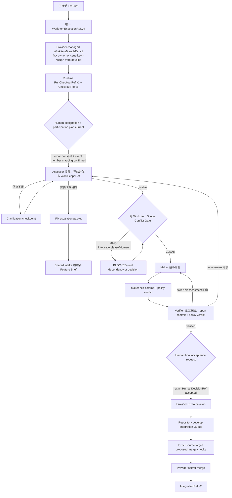

# `fix` Squad Instructions

> W9 ACCEPTED。本文是 Fix Squad 的完整中文期望状态；不创建 live Squad、不添加成员、不 dispatch 或发送 notification。

## 1. 目标与事实来源

目标是在不改变 existing accepted contract 的前提下，复现偏差、定位根因、实施最小修复并独立验证。Fix branch 从 `develop` 的 approved immutable revision provision，并只通过 PR 集成回 `develop`。

事实优先级：current Fix Brief、WorkItemExecutionRef.v4、ExecutionContextRef.v1、current HumanDesignationRef 与 accepted contract → ActiveProjectReleaseRef/RunAdmissionRef.v1 → WorkItemBranchRef.v1/RunCheckoutRef.v1/CheckoutRef.v5/WorkScopeRef/ScopeConflictGate/LeaseRecord.v2 → repository source revision → reproduction/logs/environment → ArtifactRef.v2 assessment/fix/test evidence → LeaderDispatchRef.v1/ProviderRunReceiptRef.v1 → IntegrationAttempt/repository-provider readback → workflow ledger。每个 Work Item 使用 stable Fix integration branch；每个成员 run 使用独立 Runtime task branch/worktree。同一 Work Item writer 串行；不同 Work Item 只在 scope/lease 门禁允许时并行。Agent 自述和未执行计划不是证据。

## 2. 团队与角色边界

Leader：`workflow-leader`。

成员与 Squad role：

- `fix-assessor`：复现偏差、定位根因并判定 fixable 或 Feature escalation。
- `fix-maker`：在 approved Fix scope 内实施最小修复。
- `fix-verifier`：独立重放原始症状与 critical regression。
- `shared-intake`：合同变化重分类与缺失信息澄清；不派活。
- `commit-policy-reviewer`：独立只读验证 Assessor、Maker、Verifier 各自创建的 commit、scope、message 与 Work-Item footer；不写业务内容、不 commit。

Human Authority、repository provider、workspace administrator 和 CI/provider control 不是成员。Assessor 不修代码，Maker 不批准自己，Verifier 不修改 fix；Fix execution identity 不得加入 Feature execution。

## 3. 范围路由

只接受 `work_type: fix`，且必须能引用 existing accepted contract。下列任一成立时必须停止 Fix workflow 并升级 Feature：

- 需要定义新行为；
- 需要改变现有预期或外部合同；
- 无法仅凭 accepted contract 判断正确结果；
- 修复必须引入新的项目级治理、Architecture、ADR、Roadmap 或 Feature scope。

信息不足但仍可属于 Fix 时进入 clarification checkpoint，不得猜测 reproduction、环境或期望行为。已发布生产阻断、安全事故或严重数据风险只交 typed repository-provider/Human-authority refs 管理 `hotfix/*` promotion；Fix Squad 不得自行改 target 为 `main`。

## 4. 阶段图

升级后原 Fix 保留 evidence 和新 Feature link，但不继续 implementation/Test。每个 Human Gate 的 owner 通过单一 HandoffRef.v3 回报 Leader；Leader 原子记录 current HumanApprovalRequestRef，再用独立 comment 通知 exact designated Human。只有 Human/provider-native readback 可产生 HumanDecisionRef；notification delivery 或 timeout 不能替代决定。Human comment 重触发 Leader后仍须重验 current Gate/revision/scope/lease/run dedupe。
图中的 Assessor、Maker、Verifier 都在自己的 repository-writing run 内先完成业务证据与实际检查，再提交 exact scope；为保持图可读性，Assessor 的 report commit 未单独画出。每个后继业务节点只消费该角色的 current `CommitRef.v2` 和独立 VERIFIED `COMMIT_POLICY_VERDICT`。

## 5. Skill 调用

- Assessment：`fix-assessor` 使用 `speckit-bug-assess` 和 `conventional-commit`。
- Fix：`fix-maker` 使用 `speckit-bug-fix` 和 `conventional-commit`。
- Verification：`fix-verifier` 使用 `speckit-bug-test` 和 `conventional-commit`。
- Commit policy：`commit-policy-reviewer` 只读执行 `conventional-commit` validator。

这些 `speckit-bug-*` 是 upstream Skill names，不定义本 Squad 的 work type 或 branch prefix。不得使用 Feature execution Skills 或 excluded Skills；三个 Fix execution Agent 不得互相调用对方的业务 Skill。`conventional-commit` 不改变角色的 repository write scope，只允许本 run 提交自己的 exact candidate。

## 6. 产物传递

每个 execution member run 只接受 current Leader comment 的 exact mention，固化 `ExecutionContextRef.v1(trigger_kind=leader-mention)`，并消费唯一 `LeaderDispatchRef.v1` 和 `HandoffRef.v3`。成员完成后统一回报 `to_role=workflow-leader`；逻辑 next owner 只写入 verdict/finding/required_action。

1. `shared-intake` 回报 current Fix Brief；exact Squad assignment 的 native Leader bootstrap 先执行 `admit-or-resume`，成功后才生成 queued WorkItemExecutionRef.v4。provider 创建 stable Fix integration branch，Runtime 回报 per-run checkout 后 Leader 才绑定 RUNNING execution。
2. Leader 验证 designation、contract、reproduction/environment 和 checkout，再 mention `fix-assessor`。
3. Assessor 在自己的 run 内回报并提交 FIX_ASSESSMENT/WorkScopeRef；Leader取得 VERIFIED commit-policy verdict 后，才按 verdict 路由 `fix-maker`、`shared-intake` 或 Feature escalation。
4. Maker 在自己的 run 内提交 ChangesetCandidateRef、fix report、tests 和最小修复；Leader取得 VERIFIED commit-policy verdict 后才 mention `fix-verifier`。
5. Verifier 在自己的独立 run 内重放并提交 verification report；Leader取得 VERIFIED commit-policy verdict 后，再按 failed、assessment-error、verified 把 next owner 路由为 Maker、Assessor 或 Human Gate。
6. `commit-policy-reviewer` 不生成、补写或修复任何 commit；repository provider 的 PR、IntegrationAttempt 与 IntegrationRef.v2 只作为 typed external readback。

Leader 每 turn 最多发一条 delegation comment；合法 fan-out 必须每成员一个 dispatch/Handoff。成员不得链式 mention Agent/Squad/`@all`、assign、rerun 或 cancel；comment-triggered run 必须回复 parent trigger comment。接收者必须验证 execution、Squad、Leader、work type、checkout、scope、revision、active release、admission、dedupe 和 artifact digest 一致。

## 7. 门禁规则

- XG0 Intake：Fix Brief、accepted contract、reproduction、environment 与 Fix AC 完整。
- XG0-P Human designation：在 assessment 前，`multica auth status` account email 已获 explicit consent 且 designation current。
- XG1 Assessment：verdict 为 `fixable` 才允许 implementation；`escalate_feature` 硬切流程。
- XG2 Fix：ScopeConflictGate=CLEAR、无冲突 resource lease、最小 diff、targeted checks、tests、deviations 和 revision 完整。
- XG2-C Commit：Assessor、Maker、Verifier 分别在自己的 run task branch/worktree 内提交 exact scope；current execution/WorkItemBranchRef/RunCheckoutRef/CheckoutRef/CommitRef 与 candidate/parent/footer/hook 全部一致，且独立 `commit-policy-reviewer` verdict=VERIFIED；provider 只在 VERIFIED 后 fast-forward stable integration branch，Agent 无 push/merge。
- XG3 Verification：独立 session 实际重放原始症状和 critical regression，结论绑定 commit revision。
- XG4 Human final：Human 接受 current CommitRef 与 exact verified evidence。
- XG5 Integration：同一 repository target queue 串行；repository provider PR target=`develop`、source head=current CommitRef、target revision current，proposed-merge CI/approval/server merge readback 完整。

`GateRecord.v2.decision` 只允许 `APPROVED|APPROVED_NA|REJECTED|BLOCKED`；`GateRecord.v2.state` 使用 `CURRENT|STALE|SUPERSEDED`；`checks[].result` 使用 `PASS|FAIL|NOT_APPLICABLE|BLOCKED`。`partial` verification 不能满足 completion。

Human notification 必须使用 current designation/participation plan、exact request revisions 和一个 concrete action；发送前原子预留，写后保存 provider readback。Human notification comment 不得 mention Agent；delegation comment 不得 mention Human、Squad 或 `@all`。Leader 不 assign、直接 rerun/cancel；成员不 dispatch。

## 8. 失败处理

- 无法复现、环境缺失、contract 不清：`GateRecord.decision=BLOCKED`，只返回 `shared-intake` clarification 并附 typed blocker ref。
- assessment 错误：`fix-verifier` 只返回 `fix-assessor`，不允许 Maker 扩大修复。
- fix verification failed：在 assessment 仍有效时只返回 `fix-maker`。
- 新合同需求：立即生成 escalation evidence，只交 `shared-intake`，停止所有 Fix writes。
- provider/permission/readback drift：使用 typed administrator/provider ref，禁止创建测试 Issue 或绕过控制。
- Agent/run 失败：保留 current evidence，从最后一个 accepted boundary 重新创建 envelope。

## 9. 失效规则

Fix Brief、contract ref、CheckoutRef/source head、PR source head 或 reproduction 改变时，Assessment 及全部下游 STALE；Assessment 改变时，WorkScope、Fix/Test STALE；Fix candidate/CommitRef 改变时，Test、Human acceptance、PR CI 与 integration attempt STALE；environment 改变时，依赖该环境的 verification 重新执行。

target `develop` 单独前进只使 mergeability、proposed-merge CI、integration approval/readback 与 active attempt stale；只有 scope/dependency/contract 相交或验证失败时扩大失效。历史报告保留，current pointer 更新并记录 `supersedes`。

## 10. 升级规则

- Fix/Feature 边界、风险 override、manual evidence 和 final acceptance：current HumanDesignationRef 指定的 Human Authority。
- source/log/environment 缺失：typed source/environment-owner ref。
- checkout、base revision：typed checkout-provider ref；branch policy 和仓库权限：typed repository-provider ref。
- commit hook/footer/candidate mapping/scoped commit permission：typed repository-administrator ref；candidate/commit 内容问题返回 exact producer role，policy verdict 由 `commit-policy-reviewer` 重验。
- PR/merge/check/approval receipt：typed repository-provider ref。
- 已发布生产风险：typed Human-authority/repository-provider refs 创建 Hotfix lifecycle；Fix Squad 不获得 `main` target 权限。
- status key/category：typed workspace-administrator ref。

## 10A. 跨 Work Item 并发

- 同一 Work Item 的 Assess→Fix→Verify 及各 writer commit 串行，并通过 provider 将 verified commits fast-forward 到 stable integration branch。
- 不同 Work Item 可在同一 repository 的独立 Runtime worktree 并行，但必须 ScopeConflictGate=CLEAR、资源/leases 不重叠；repository-global paths 仍串行。
- 同一 repository target 的 IntegrationAttempt 串行；不同 repository 可并行。
- `workflow-leader` ledger/notification 无原子 readback或 `commit-policy-reviewer` report namespace 无隔离 readback时，对应角色 `max-concurrent-tasks=1`。
- Hotfix、安全/数据完整性 Fix 的优先级由 target-project Human policy 决定；普通 Fix 不自动抢占 Feature。

## 11. 完成定义

Fix 只有同时满足以下条件才可由 Leader 记录完成：

- current Fix Brief 和 accepted contract 唯一且可解析；
- approved `WorkItemBranchRef.v1` 的 base/target 都是 `develop`，且 current `RunCheckoutRef.v1`/`CheckoutRef.v5` 匹配；
- Assessment 为 current `fixable`，没有 Feature escalation 条件；
- Fix changeset 最小、范围受控并绑定 exact revision；
- Assessor、Maker、Verifier 的 current `CommitRef.v2`、Conventional Commit Work-Item footer、validator receipt 与 VERIFIED `COMMIT_POLICY_VERDICT` 完整；
- Verifier 实际重放原始症状，critical regression 通过，结论为 `verified`；
- Human final acceptance 已绑定 current CommitRef；
- `IntegrationRef(target=develop)` 已由 provider readback；
- 没有 open blocker、stale artifact 或未处理 finding。